# Chapitre 2 : Structure de base d'un ordinateur

*Tronc Commun — Cours d'informatique — Architecture matérielle (Hardware)*

## Plan du cours

1. L'ordinateur
2. Schéma fonctionnel d'un ordinateur
3. Le CPU (processeur)
4. Le système de bus
5. La mémoire centrale (RAM / ROM)
6. Le stockage (mémoire de masse)
7. Les unités d'entrée / sortie (interfaces et périphériques)
8. La carte mère

## 1. L'ordinateur

> **Définition** : Un ordinateur est une machine électronique capable de recevoir des données (informations), de les traiter automatiquement selon un programme (une suite d'instructions), puis de restituer un résultat, et de conserver ces informations.

> **Exemple** : Ordinateur de bureau (PC), ordinateur portable, tablette, serveur. On y trouve tous les jours un ordinateur : au collège, à la banque, dans une caisse de supermarché, dans un téléphone intelligent…

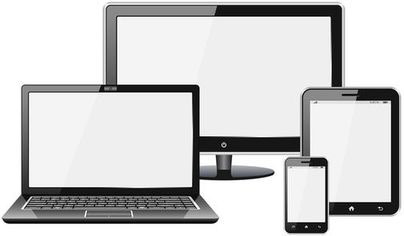

*Ordinateur de bureau / portable*

Un ordinateur exécute 4 opérations de base sur l'information :

- **Entrée** : recevoir des données (ex : taper un texte au clavier)
- **Traitement** : transformer/calculer ces données (ex : corriger l'orthographe)
- **Sortie** : afficher ou restituer le résultat (ex : voir le texte à l'écran)
- **Stockage** : conserver les données pour les réutiliser plus tard (ex : enregistrer le fichier)

## 2. Schéma fonctionnel d'un ordinateur

> **Définition** : Le schéma fonctionnel représente les grandes parties d'un ordinateur et la manière dont l'information circule entre elles : de l'entrée vers le traitement, puis vers la sortie, avec une mémoire pour conserver les données.

Voir l'exercice 2 dans les [exercices du chapitre 2](../exercices/ch2-exercices.html).

Toutes les flèches représentent la circulation de l'information, assurée physiquement par le système de bus (voir partie 4).

## 3. Le CPU (processeur)

> **Définition** : Le CPU (Central Processing Unit), ou microprocesseur, est le « cerveau » de l'ordinateur. Il exécute les instructions des programmes : il fait les calculs et prend les décisions logiques.

**Ses principaux composants**

- **UAL** (Unité Arithmétique et Logique) : effectue les calculs (addition, comparaison...)
- **UC** (Unité de Commande) : dirige et synchronise le travail des autres éléments
- **Les registres** : petites mémoires ultra-rapides intégrées au CPU pour stocker temporairement les données en cours de traitement

**Caractéristiques importantes**

- **La fréquence** (en GHz) : nombre de cycles exécutés par seconde (1 GHz = 1 milliard de cycles par seconde)
- **Le nombre de cœurs** : un CPU « multi-cœurs » peut traiter plusieurs tâches en même temps

> **Exemple** : Intel Core i5, Intel Core i7, AMD Ryzen 5. Un processeur à 3,5 GHz effectue environ 3,5 milliards de cycles par seconde.

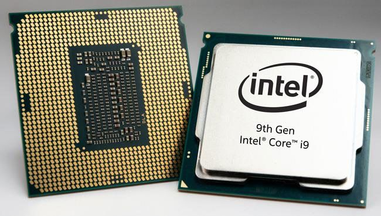

*Photo réelle : Processeur (CPU)*

## 4. Le système de bus

> **Définition** : Un bus est un ensemble de fils électriques (circuits) qui transportent l'information entre les différents composants de l'ordinateur (CPU, mémoire, périphériques).

On peut comparer le système de bus aux routes d'une ville : elles permettent aux voitures (les données) de circuler entre les quartiers (les composants).

**Les trois types de bus**

| Type de bus | Rôle | Exemple |
|---|---|---|
| Bus de données | Transporte les données elles-mêmes (les informations à traiter) | Envoi du contenu d'un fichier vers le CPU |
| Bus d'adresses | Transporte l'adresse mémoire où se trouve ou doit aller l'information | Indiquer où lire une donnée en RAM |
| Bus de commande (contrôle) | Transporte les signaux de synchronisation (lecture/écriture, horloge) | Signal « écrire en mémoire » |

## 5. La mémoire centrale (RAM / ROM)

> **Définition** : La mémoire centrale est la mémoire directement accessible par le CPU. Elle est composée de deux types : la RAM et la ROM.

### 5.1 La RAM (Random Access Memory)

> **Définition** : La RAM, ou mémoire vive, est une mémoire volatile : elle stocke temporairement les programmes et données en cours d'utilisation, et son contenu s'efface quand l'ordinateur s'éteint.

> **Exemple** : Barrette de RAM DDR4 de 8 Go ou 16 Go. Plus la RAM est grande, plus l'ordinateur peut exécuter de programmes en même temps sans ralentir.

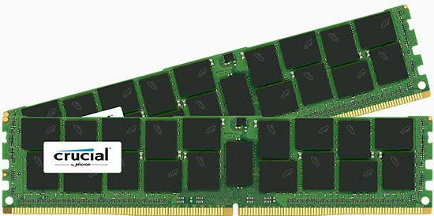

*Photo réelle : Barrette de RAM*

### 5.2 La ROM (Read Only Memory)

> **Définition** : La ROM, ou mémoire morte, est une mémoire non volatile en lecture seule : son contenu reste même sans alimentation électrique. Elle contient les instructions nécessaires au démarrage de l'ordinateur.

> **Exemple** : Le BIOS/UEFI, programme stocké en ROM, qui démarre l'ordinateur avant même le chargement du système d'exploitation.

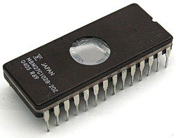

| Critère | RAM | ROM |
|---|---|---|
| Volatilité | Volatile (efface au redémarrage) | Non volatile (conserve les données) |
| Lecture/Écriture | Lecture et écriture | Lecture seule (généralement) |
| Rôle | Exécution des programmes en cours | Démarrage de l'ordinateur (BIOS) |
| Vitesse | Très rapide | Rapide |

## 6. Le stockage (mémoire de masse)

> **Définition** : La mémoire de stockage (ou mémoire secondaire) permet de conserver les données de façon permanente, même lorsque l'ordinateur est éteint, contrairement à la RAM.

> **Exemple** : Disque dur (HDD), disque SSD, clé USB, carte mémoire SD, CD/DVD, disque dur externe.

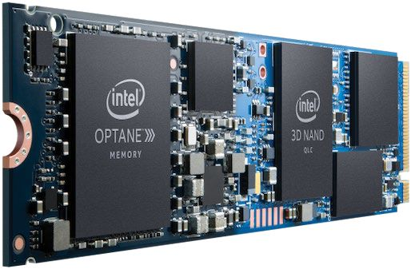 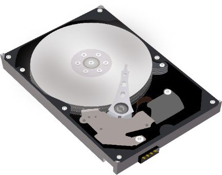

*Photo réelle : Disque dur (HDD) et SSD*

|  | RAM (mémoire centrale) | Stockage (mémoire de masse) |
|---|---|---|
| Persistance | Volatile | Permanente |
| Vitesse | Très rapide | Plus lente |
| Capacité typique | 4 à 32 Go | 256 Go à plusieurs To |
| Exemple | Barrette DDR4 | SSD, disque dur |

## 7. Les unités d'entrée et de sortie (interfaces et périphériques)

> **Définition** : Les unités d'entrée/sortie permettent à l'ordinateur de communiquer avec le monde extérieur (l'utilisateur ou d'autres appareils). Elles regroupent les interfaces (connexions) et les périphériques (appareils).

### 7.1 Les interfaces

Une interface est l'élément physique qui permet de relier un périphérique à l'unité centrale.

#### a. Les cartes d'extension

> **Définition** : Une carte d'extension est un circuit électronique que l'on insère dans un connecteur (slot) de la carte mère pour ajouter ou améliorer une fonctionnalité.

> **Exemple** : Carte graphique (pour l'affichage), carte son, carte réseau Wi-Fi.

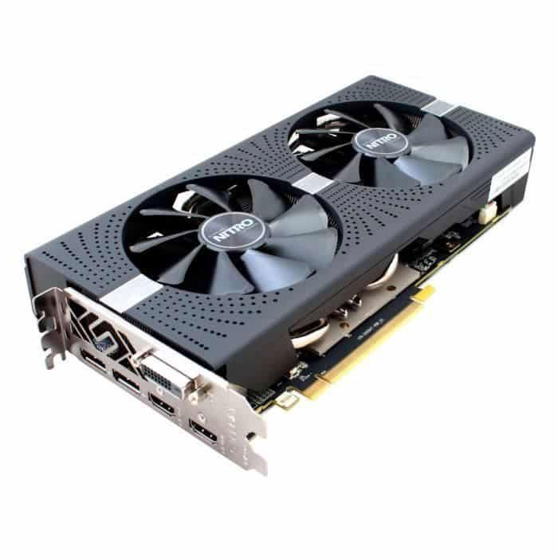

*Carte graphique (carte d'extension)*

#### b. Les ports

> **Définition** : Un port est un point de connexion, visible à l'extérieur du boîtier, où l'on branche physiquement un périphérique.

> **Exemple** : Port USB, port HDMI (écran), port Ethernet (réseau), port jack (audio), port VGA.

| Ports | Description ou/et Exemple d'utilisation | Image |
|---|---|---|
| COM | (Série ou RS-232) : obsolète (utilisé auparavant pour les souris, claviers, modems externes) | 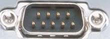 |
| Parallèle | Anciennes imprimantes (en voie de disparition) | 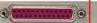 |
| PS/2 | Souris et claviers (en voie de remplacement par le port USB) | 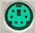 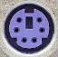 |
| USB | (Sigle de l'anglais Universal Serial Bus, bus série universel), Bus rapide qui permet de connecter de nombreux périphériques : souris, clavier, imprimante, vidéoprojecteur | 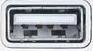 |
| VGA | Video Graphics Array, Écran cathodique, écrans plats, vidéoprojecteur | 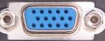 |
| DVI | (Digital visual interface) Écrans plats, vidéoprojecteur | 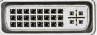 |
| HDMI | (High-Definition Multimedia Interface), Écrans plats, vidéoprojecteur | 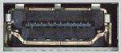 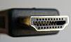 |
| Ethernet RJ-45 | Pour les connexions Ethernet | 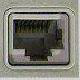 |
| Modem RJ-11 | Utilisé par des appareils téléphoniques fixes | 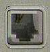 |

### 7.2 Les périphériques

Un périphérique est tout appareil relié à l'unité centrale et qui n'en fait pas partie physiquement.

#### a. Périphériques d'entrée

> **Définition** : Ils permettent à l'utilisateur d'envoyer des données ou des instructions vers l'ordinateur.

> **Exemple** : Clavier, souris, scanner, webcam, microphone, manette de jeu.

Voir l'exercice 1 (images 1 à 8) dans les [exercices du chapitre 2](../exercices/ch2-exercices.html).

#### b. Périphériques de sortie

> **Définition** : Ils permettent de restituer à l'utilisateur le résultat du traitement effectué par l'ordinateur.

> **Exemple** : Écran (moniteur), imprimante, haut-parleurs, vidéoprojecteur.

Voir l'exercice 1 (images 9 à 12) dans les [exercices du chapitre 2](../exercices/ch2-exercices.html).

#### c. Périphériques d'entrée/sortie

> **Définition** : Ce sont des périphériques qui remplissent à la fois le rôle d'entrée et de sortie.

> **Exemple** : Écran tactile, casque avec micro intégré, imprimante multifonction (scanner + imprimante), modem/routeur.

Voir l'exercice 1 (images 13 à 16) dans les [exercices du chapitre 2](../exercices/ch2-exercices.html).

## 8. La carte mère

> **Définition** : La carte mère (motherboard) est le circuit imprimé principal de l'ordinateur. Elle relie et alimente tous les composants (CPU, mémoire centrale, cartes d'extension, stockage) grâce au système de bus.

**Ses éléments principaux**

- **Le socket** : emplacement où se fixe le CPU
- **Les slots mémoire** : emplacements pour les barrettes de RAM
- **Les slots d'extension (PCIe)** : pour insérer les cartes d'extension
- **Les connecteurs de stockage (SATA, M.2)** : pour brancher disque dur / SSD
- **Les ports arrière** : USB, HDMI, Ethernet, audio…
- **Le chipset** : gère la communication entre les composants

> **Exemple** : Cartes mères ASUS, MSI, Gigabyte, aux formats ATX, micro-ATX ou mini-ITX selon la taille du boîtier.

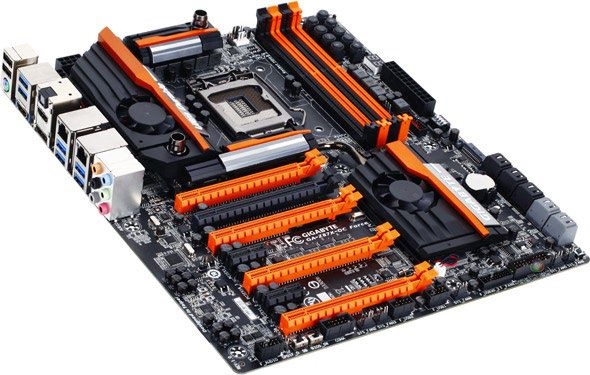

*Carte mère complète*

## Résumé

L'ordinateur reçoit des données (entrée), les traite grâce au CPU en utilisant la mémoire centrale (RAM/ROM), les fait circuler via le système de bus, restitue un résultat (sortie), et peut conserver les informations durablement (stockage). Tous ces composants sont reliés physiquement par la carte mère, qui constitue le squelette de l'ordinateur.

Voir l'exercice 3 dans les [exercices du chapitre 2](../exercices/ch2-exercices.html).
