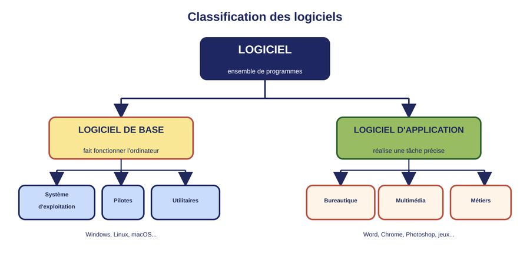

# Chapitre 3 : Les logiciels

*Chapitre 3*

## Sommaire du cours

- I. Qu'est-ce qu'un logiciel ?
- II. Logiciel de base
- III. Les logiciels d'application

## I. Qu'est-ce qu'un logiciel ?

> **Définition** : Logiciel — Un logiciel (en anglais « software ») est un ensemble de programmes, de données et de procédures qui permettent de réaliser une tâche précise sur un ordinateur. Il s'oppose au matériel (hardware), qui désigne les composants physiques de l'ordinateur.

Sans logiciel, un ordinateur n'est qu'une machine vide : c'est le logiciel qui lui donne des instructions et qui le rend utile. On dit souvent que le matériel est le « corps » de l'ordinateur et le logiciel son « esprit ».

### Logiciel et programme : quelle différence ?

- **Un programme** : une suite d'instructions écrites dans un langage de programmation, destinée à effectuer une tâche précise.
- **Un logiciel** : un ensemble plus complet, qui regroupe un ou plusieurs programmes, accompagnés de données et d'une documentation, prêt à être installé et utilisé.

### Les deux grandes catégories de logiciels

On classe généralement les logiciels en deux grandes familles, selon leur rôle :

- **Le logiciel de base** : indispensable au fonctionnement même de l'ordinateur.
- **Le logiciel d'application** : destiné à réaliser une tâche précise pour l'utilisateur.

*Figure 1 — Classification des logiciels*

> **Remarque** : la figure présente trois familles d'applications à titre d'exemple. La partie III détaille cinq familles : bureautique, communication et internet, multimédia, jeux et loisirs, logiciels métiers.

> **Exemple** :
> - Windows, Linux et macOS sont des logiciels de base (systèmes d'exploitation).
> - Microsoft Word, Google Chrome et un jeu vidéo sont des logiciels d'application.

## II. Logiciel de base

> **Définition** : Logiciel de base — Un logiciel de base (ou logiciel système) est un logiciel indispensable qui permet à l'ordinateur de démarrer, de gérer ses ressources matérielles et de faire fonctionner les autres logiciels. Il constitue l'intermédiaire entre le matériel et l'utilisateur.

Le logiciel de base regroupe trois grandes catégories :

### 1. Le système d'exploitation (Operating System)

C'est le logiciel de base principal. Il gère les ressources de l'ordinateur (processeur, mémoire, stockage), organise les fichiers et permet à l'utilisateur d'interagir avec la machine et de lancer d'autres logiciels.

- Windows
- macOS
- Linux

### 2. Les pilotes (drivers)

Un pilote est un petit programme qui permet au système d'exploitation de communiquer correctement avec un périphérique matériel (imprimante, carte graphique, souris...).

> **Exemple** :
> - Le pilote d'une imprimante, installé pour pouvoir imprimer un document.
> - Le pilote d'une carte graphique, qui permet d'afficher des jeux en haute définition.

### 3. Les utilitaires

Un utilitaire est un programme qui aide à entretenir, protéger ou optimiser le fonctionnement de l'ordinateur.

- Antivirus
- Compression de fichiers
- Sécurité / Sauvegarde

> **Exemple** :
> - Un antivirus comme Windows Defender ou Avast.
> - Un logiciel de compression comme WinRAR ou 7-Zip.
> - Un logiciel de nettoyage de disque dur.

## III. Les logiciels d'application

> **Définition** : Logiciel d'application — Un logiciel d'application (ou logiciel applicatif) est un logiciel installé sur le système d'exploitation, destiné à réaliser une tâche précise pour répondre à un besoin de l'utilisateur : écrire, calculer, communiquer, dessiner, jouer...

Contrairement au logiciel de base, le logiciel d'application n'est pas indispensable au fonctionnement de l'ordinateur : il peut être installé, désinstallé ou remplacé selon les besoins.

### 1. Logiciels de bureautique

Ils servent à produire des documents de travail : textes, tableaux, présentations.

- Traitement de texte (Word)
- Tableur (Excel)
- Présentation (PowerPoint)

### 2. Logiciels de communication et d'internet

Ils permettent de naviguer sur le web, d'envoyer des messages ou de communiquer à distance.

- Navigateur web (Chrome, Firefox)
- Messagerie (Gmail, Outlook)

### 3. Logiciels multimédias

Ils servent à créer, modifier ou lire des images, des sons ou des vidéos.

- Retouche d'image (Photoshop)
- Lecture audio (VLC, Spotify)
- Montage vidéo (Premiere)

### 4. Logiciels de jeux et de loisirs

- Jeux vidéo
- Logiciels éducatifs

### 5. Logiciels métiers / professionnels

Ils répondent à des besoins spécifiques d'un domaine professionnel.

- Comptabilité & Gestion
- Gestion d'entreprise (ERP)

> **Exemple** :
> - Un élève qui rédige un exposé utilise un logiciel de bureautique (Word).
> - Un graphiste qui retouche une photo utilise un logiciel multimédia (Photoshop).
> - Un comptable qui gère les factures d'une entreprise utilise un logiciel métier.

## Synthèse : logiciel de base ou logiciel d'application ?

| Logiciel de base | Logiciel d'application |
|---|---|
| Indispensable au fonctionnement de l'ordinateur | Répond à un besoin particulier de l'utilisateur |
| Généralement installé avec l'ordinateur | Installé volontairement par l'utilisateur |
| Exemple : Windows, pilote d'imprimante, antivirus | Exemple : Word, Chrome, Photoshop, jeu vidéo |

**En résumé** : le logiciel de base fait fonctionner l'ordinateur, tandis que le logiciel d'application permet à l'utilisateur de réaliser une tâche précise grâce à cet ordinateur.
