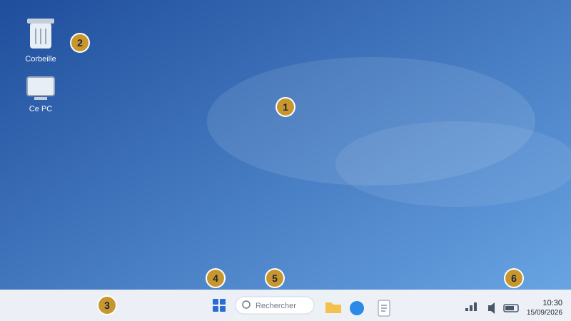
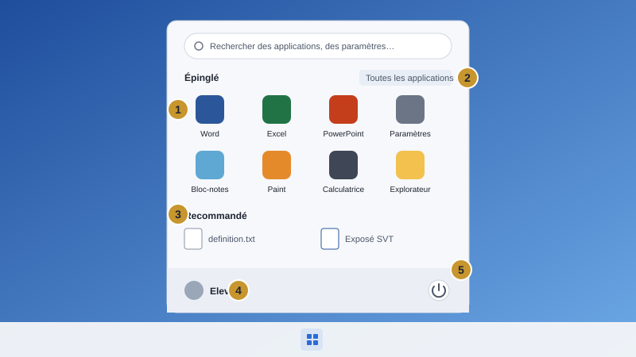
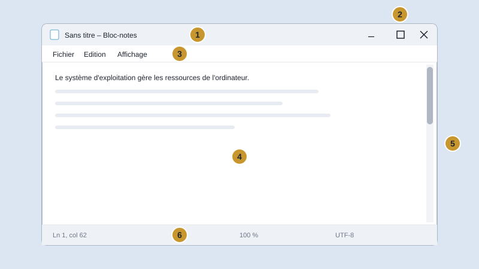
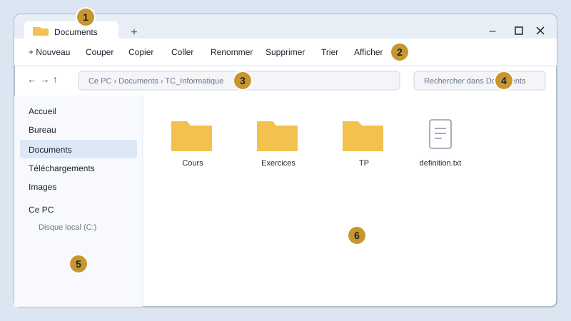

# Chapitre 1 : Système d'exploitation (Windows 11)

## Objectifs d'apprentissage

- Définir un système d'exploitation et citer ses principales fonctions.
- Identifier et utiliser les éléments de l'environnement Windows 11 (bureau, barre des tâches, menu Démarrer, fenêtres, paramètres).
- Organiser ses données : créer une arborescence, manipuler fichiers et dossiers, écrire un chemin d'accès.

## 1. Fonctionnalités de base d'un système d'exploitation

### 1.1 Mise en situation

Lorsque tu appuies sur le bouton d'alimentation d'un ordinateur, l'écran s'allume, un logo apparaît puis le bureau s'affiche : tu peux alors ouvrir un navigateur, écrire un texte ou écouter de la musique. Entre le matériel (processeur, mémoire, disque, clavier, écran…) et toi, un logiciel très particulier travaille en permanence : le système d'exploitation.

### 1.2 Définition

> **Définition** : Le système d'exploitation (SE, en anglais Operating System — OS) est l'ensemble des programmes qui gèrent les ressources matérielles et logicielles de l'ordinateur et qui servent d'intermédiaire entre l'utilisateur, les logiciels d'application et le matériel.

C'est le premier logiciel chargé en mémoire au démarrage de l'ordinateur.

### 1.3 Place du système d'exploitation

On représente souvent un système informatique sous forme de couches. Chaque couche utilise les services de la couche située en dessous :

| Couche | Rôle | Exemples |
|---|---|---|
| Utilisateur | Donne des ordres, utilise les applications | Élève, enseignant |
| Logiciels d'application | Réalisent des tâches précises | Word, Chrome, VLC, Paint |
| Système d'exploitation | Gère les ressources, fait le lien | Windows 11, Linux, macOS |
| Matériel | Exécute physiquement les opérations | Processeur, RAM, disque, écran |

### 1.4 Exemples de systèmes d'exploitation

| Système | Éditeur / origine | Type d'appareil | Licence |
|---|---|---|---|
| Windows 11 | Microsoft | Ordinateurs (PC) | Propriétaire (payant) |
| macOS | Apple | Ordinateurs Mac | Propriétaire |
| Linux (Ubuntu, Debian…) | Communauté / divers | PC, serveurs | Libre et gratuit |
| Android | Google | Smartphones, tablettes | Basé sur Linux, open source |
| iOS / iPadOS | Apple | iPhone, iPad | Propriétaire |

### 1.5 Les fonctions principales d'un système d'exploitation

| Fonction | Ce que fait le système d'exploitation |
|---|---|
| Gestion du processeur | Répartit le temps du processeur entre les programmes en cours d'exécution (processus) pour qu'ils semblent fonctionner en même temps. |
| Gestion de la mémoire | Attribue à chaque programme une zone de la mémoire vive (RAM) et la libère quand le programme se ferme. |
| Gestion des périphériques | Communique avec le clavier, la souris, l'imprimante, la clé USB… grâce à des petits programmes appelés pilotes (drivers). |
| Gestion des fichiers | Organise l'enregistrement des données sur les supports de stockage sous forme de fichiers et de dossiers. |
| Interface utilisateur | Permet à l'utilisateur de dialoguer avec la machine : interface graphique (fenêtres, icônes) ou ligne de commande. |
| Sécurité et comptes | Contrôle l'accès grâce aux comptes utilisateurs et mots de passe, protège contre les logiciels malveillants. |

> **À retenir** :
>
> - Sans système d'exploitation, un ordinateur ne peut pas être utilisé par un utilisateur ordinaire.
> - Le SE est un gestionnaire : processeur, mémoire, périphériques, fichiers, sécurité.

### 1.6 Types d'interfaces

- **Interface graphique (GUI)** : on utilise la souris, les icônes, les fenêtres et les menus. Exemple : le bureau de Windows 11.
- **Interface en ligne de commande (CLI)** : on tape des commandes au clavier. Exemple : l'Invite de commandes (cmd) ou PowerShell sous Windows, le Terminal sous Linux.

### 1.7 Classification des systèmes d'exploitation

| Critère | Catégorie | Explication |
|---|---|---|
| Nombre de tâches | Monotâche | Exécute un seul programme à la fois (ex. MS-DOS). |
| Nombre de tâches | Multitâche | Exécute plusieurs programmes simultanément (ex. Windows 11, Linux). |
| Nombre d'utilisateurs | Monoposte / mono-utilisateur | Un seul utilisateur à la fois. |
| Nombre d'utilisateurs | Multi-utilisateur | Plusieurs comptes ou utilisateurs peuvent travailler (ex. Linux, Windows 11). |

### 1.8 Le démarrage de l'ordinateur

1. Mise sous tension : le micrologiciel UEFI (anciennement BIOS) s'exécute.
2. Il teste le matériel (POST : Power-On Self Test).
3. Il recherche le support de démarrage (disque, clé USB…).
4. Il charge le système d'exploitation en mémoire vive.
5. Le SE affiche l'écran de connexion puis le bureau.

> **Attention** : Pour éteindre un ordinateur, on utilise Démarrer › Marche/Arrêt › Arrêter. Couper brutalement le courant peut endommager le système ou faire perdre des données non enregistrées.

## 2. L'environnement Windows 11

### 2.1 Ouverture de session

Au démarrage, Windows 11 affiche l'écran de verrouillage. On clique (ou on appuie sur une touche) puis on choisit son compte et on saisit son mot de passe ou son code PIN. Chaque utilisateur possède son propre bureau, ses propres documents et ses propres réglages.

### 2.2 Le bureau

Le bureau est l'écran principal qui s'affiche après l'ouverture de session. Il contient :

| Élément | Description |
|---|---|
| Fond d'écran | Image ou couleur affichée en arrière-plan ; elle est personnalisable. |
| Icônes | Petites images représentant un programme, un fichier, un dossier ou un raccourci (ex. Corbeille, Ce PC). |
| Barre des tâches | Bande située en bas de l'écran ; dans Windows 11 ses icônes sont centrées. |
| Bouton Démarrer | Logo Windows ; ouvre le menu Démarrer. |
| Zone de recherche | Permet de rechercher une application, un fichier ou un paramètre. |
| Zone de notification | À droite : heure, date, volume, réseau Wi-Fi, batterie, notifications. |



*Figure 1 : Schéma du bureau de Windows 11.*

1. Fond d'écran
2. Icônes (Corbeille, Ce PC)
3. Barre des tâches
4. Bouton Démarrer
5. Zone de recherche
6. Zone de notification

### 2.3 Le menu Démarrer

- **Applications épinglées** : raccourcis vers les applications favorites.
- **Bouton « Toutes les applications »** : liste alphabétique de tous les programmes installés.
- **Section « Recommandé »** : fichiers et applications récemment utilisés.
- **En bas** : nom de l'utilisateur (changer de compte, verrouiller, se déconnecter) et bouton Marche/Arrêt (Veille, Arrêter, Redémarrer).



*Figure 2 : Schéma du menu Démarrer.*

1. Applications épinglées
2. Bouton « Toutes les applications »
3. Section « Recommandé »
4. Nom de l'utilisateur
5. Bouton Marche/Arrêt

### 2.4 Les icônes et raccourcis

Un raccourci est une icône portant une petite flèche en bas à gauche. Il ne contient pas le programme ou le fichier lui-même : il pointe vers son emplacement. Supprimer un raccourci ne supprime pas le fichier d'origine.

### 2.5 Utilisation de la souris

| Action | Comment ? | Résultat habituel |
|---|---|---|
| Pointer | Déplacer la souris sur un élément | Affiche une info-bulle |
| Clic gauche | Appuyer une fois sur le bouton gauche | Sélectionner un élément |
| Double-clic | Deux clics gauches rapides | Ouvrir un fichier, un dossier, un programme |
| Clic droit | Appuyer sur le bouton droit | Afficher le menu contextuel |
| Glisser-déposer | Maintenir le clic gauche et déplacer | Déplacer ou copier un élément |
| Molette | Faire tourner la roulette | Faire défiler le contenu |

### 2.6 Les fenêtres

Chaque application ou dossier ouvert s'affiche dans une fenêtre. Une fenêtre Windows 11 comporte en général :

- **La barre de titre** : nom de l'application ou du dossier ; on la fait glisser pour déplacer la fenêtre.
- **Les boutons de contrôle** (en haut à droite) : Réduire (–), Agrandir / Restaurer (□), Fermer (×).
- **La barre de menus ou le ruban / la barre de commandes** : regroupe les commandes de l'application.
- **La zone de travail** : contenu du document ou du dossier.
- **Les barres de défilement** : apparaissent lorsque le contenu dépasse la taille de la fenêtre.
- **La barre d'état** (en bas) : informations (nombre d'éléments, page, zoom…).

> **Remarque** : **Nouveauté Windows 11 : les dispositions d'ancrage (Snap layouts).** Pointer le bouton Agrandir d'une fenêtre (ou appuyer sur Windows + Z) affiche des modèles de disposition pour placer plusieurs fenêtres côte à côte. Windows + ← ou Windows + → ancre la fenêtre active sur la moitié gauche ou droite de l'écran.



*Figure 3 : Schéma d'une fenêtre.*

1. Barre de titre
2. Boutons de contrôle
3. Barre de menus
4. Zone de travail
5. Barre de défilement
6. Barre d'état

### 2.7 Les paramètres de Windows 11

L'application Paramètres (Windows + I) regroupe les réglages du système :

| Catégorie | Exemples de réglages |
|---|---|
| Système | Affichage (résolution, luminosité), son, notifications, stockage |
| Bluetooth et appareils | Souris, imprimantes, clés USB |
| Réseau et Internet | Wi-Fi, Ethernet, mode avion |
| Personnalisation | Arrière-plan, couleurs, thèmes, écran de verrouillage, barre des tâches |
| Applications | Applications installées, applications par défaut |
| Comptes | Votre compte, options de connexion (PIN, mot de passe) |
| Heure et langue | Date et heure, langue, disposition du clavier (AZERTY, arabe…) |
| Windows Update | Mises à jour du système |

### 2.8 Raccourcis clavier essentiels

| Raccourci | Action |
|---|---|
| Windows | Ouvrir / fermer le menu Démarrer |
| Windows + D | Afficher le bureau |
| Windows + E | Ouvrir l'Explorateur de fichiers |
| Windows + I | Ouvrir les Paramètres |
| Windows + L | Verrouiller la session |
| Alt + Tab | Passer d'une fenêtre ouverte à une autre |
| Alt + F4 | Fermer la fenêtre active |
| Windows + Maj + S | Faire une capture d'écran (Outil Capture) |
| Ctrl + Maj + Échap | Ouvrir le Gestionnaire des tâches |

## 3. Gestion des fichiers et des dossiers

### 3.1 Notion de fichier

> **Définition** : Un fichier est un ensemble de données (texte, image, son, vidéo, programme…) enregistré sur un support de stockage et identifié par un nom.

Le nom complet d'un fichier est composé de deux parties séparées par un point : `nom.extension` (ex. `rapport.docx`). L'extension (en général 3 ou 4 lettres) indique le type du fichier et le programme qui permet de l'ouvrir.

| Extension | Type de fichier | Programme associé (exemple) |
|---|---|---|
| .txt | Texte simple | Bloc-notes |
| .docx | Document de traitement de texte | Microsoft Word |
| .xlsx | Classeur (tableur) | Microsoft Excel |
| .pptx | Présentation | Microsoft PowerPoint |
| .pdf | Document portable | Navigateur, lecteur PDF |
| .jpg / .png | Image | Photos, Paint |
| .mp3 | Son / musique | Lecteur multimédia |
| .mp4 | Vidéo | Lecteur multimédia |
| .exe | Programme exécutable | Windows (lance le programme) |
| .zip | Dossier compressé | Explorateur de fichiers |

> **Attention** : **Caractères interdits.** Un nom de fichier ou de dossier ne peut pas contenir les caractères suivants : `\ / : * ? " < > |`

### 3.2 Notion de dossier

> **Définition** : Un dossier (ou répertoire) est un conteneur qui permet de ranger des fichiers et d'autres dossiers (appelés sous-dossiers).

Les dossiers permettent d'organiser son travail, comme les classeurs et les chemises dans un cartable.

### 3.3 Les unités de stockage (lecteurs)

- **C:** — disque local principal, contient Windows et les programmes.
- **D:, E:…** — autres partitions, lecteur DVD, clé USB, disque externe.
- **OneDrive** — espace de stockage en ligne (cloud) de Microsoft.

### 3.4 L'arborescence

L'organisation des dossiers et sous-dossiers forme une arborescence (structure en arbre). Le point de départ, le lecteur (ex. C:), est appelé la **racine**.

```
C:
└── Utilisateurs
    └── Eleve
        ├── Documents
        │   └── TC_Informatique
        │       ├── Cours
        │       │   └── systeme.docx
        │       └── TP
        ├── Images
        └── Musique
```

### 3.5 Le chemin d'accès

> **Définition** : Le chemin d'accès indique l'emplacement exact d'un fichier ou d'un dossier en partant de la racine. Sous Windows, les noms sont séparés par une barre oblique inverse « \ ».

> **Exemple** : le fichier `systeme.docx` de l'arborescence ci-dessus a pour chemin : `C:\Utilisateurs\Eleve\Documents\TC_Informatique\Cours\systeme.docx`

### 3.6 L'Explorateur de fichiers

L'Explorateur de fichiers (Windows + E ou icône dossier jaune de la barre des tâches) permet de parcourir et de gérer les fichiers. Ses principales zones :

| Zone | Rôle |
|---|---|
| Barre d'adresse | Affiche le chemin du dossier courant ; on peut y taper un chemin. |
| Barre de commandes | Nouveau, Couper, Copier, Coller, Renommer, Partager, Supprimer, Trier, Afficher. |
| Volet de navigation (gauche) | Accueil, Bureau, Documents, Téléchargements, Ce PC, lecteurs… |
| Zone de contenu (centre) | Fichiers et dossiers du dossier courant. |
| Zone de recherche | Recherche un fichier dans le dossier courant et ses sous-dossiers. |
| Onglets | Nouveauté Windows 11 : plusieurs dossiers ouverts dans la même fenêtre (Ctrl + T). |

Le menu **Afficher** permet de choisir le mode d'affichage (Très grandes icônes, Liste, Détails, Mosaïques…) et d'afficher les extensions de noms de fichiers (Afficher › Afficher › Extensions de noms de fichiers).



*Figure 4 : Schéma de l'Explorateur de fichiers.*

1. Onglets
2. Barre de commandes
3. Barre d'adresse
4. Zone de recherche
5. Volet de navigation
6. Zone de contenu

### 3.7 Les opérations sur les fichiers et dossiers

| Opération | Méthode (clic droit / ruban) | Raccourci |
|---|---|---|
| Créer un dossier | Clic droit dans une zone vide › Nouveau › Dossier | Ctrl + Maj + N |
| Renommer | Clic droit › Renommer (icône) | F2 |
| Copier | Clic droit › Copier, puis Coller à la destination | Ctrl + C puis Ctrl + V |
| Couper / Déplacer | Clic droit › Couper, puis Coller à la destination | Ctrl + X puis Ctrl + V |
| Supprimer | Clic droit › Supprimer (vers la Corbeille) | Suppr |
| Supprimer définitivement | Sans passer par la Corbeille | Maj + Suppr |
| Tout sélectionner | Barre de commandes › … › Sélectionner tout | Ctrl + A |
| Annuler la dernière action | — | Ctrl + Z |
| Propriétés | Clic droit › Propriétés (taille, type, date…) | Alt + Entrée |

> **À retenir** : **Copier ou déplacer ?**
>
> - **Copier** : le fichier reste à l'emplacement d'origine ET une copie est créée à la destination.
> - **Déplacer (Couper/Coller)** : le fichier quitte l'emplacement d'origine pour aller à la destination.

### 3.8 Sélectionner plusieurs éléments

- **Éléments contigus** (qui se suivent) : cliquer sur le premier, maintenir Maj et cliquer sur le dernier.
- **Éléments non contigus** : maintenir Ctrl et cliquer sur chaque élément.
- **Tous les éléments** : Ctrl + A.

### 3.9 La Corbeille

Les fichiers supprimés d'un disque interne sont placés dans la Corbeille. Tant que la Corbeille n'est pas vidée, on peut les récupérer : ouvrir la Corbeille › clic droit sur l'élément › Restaurer. Il retourne alors à son emplacement d'origine.

> **Attention** : Les fichiers supprimés d'une clé USB ne passent pas par la Corbeille : ils sont supprimés définitivement. Vider la Corbeille supprime définitivement son contenu.

### 3.10 Rechercher et compresser

- **Rechercher** : taper le nom (ou une partie) dans la zone de recherche de l'Explorateur. Le caractère `*` remplace un groupe de caractères : `*.docx` trouve tous les documents Word.
- **Compresser** : clic droit sur un fichier ou dossier › Compresser vers › Fichier ZIP. Le fichier .zip obtenu est plus léger et facile à envoyer.
- **Extraire** : clic droit sur le fichier .zip › Extraire tout.
