# Chapitre 2 : Traitement de texte (Microsoft Word 2019)

## Objectifs d'apprentissage

- Définir un texteur et citer ses fonctionnalités.
- Identifier les éléments de la fenêtre de Word 2019 et gérer ses documents (créer, enregistrer, ouvrir).
- Élaborer un document complet : saisir, mettre en forme, insérer des objets, mettre en page et imprimer.

> **Remarque** : Les images de ce chapitre sont des reproductions fidèles de l'interface de Microsoft Word 2019.

## 1. Fonctionnalités d'un texteur

### 1.1 Mise en situation

Pour rédiger un exposé, une lettre de motivation, un CV ou une invitation, on utilisait autrefois un stylo ou une machine à écrire : la moindre erreur obligeait à tout recommencer. Aujourd'hui, un logiciel permet d'écrire, de corriger, d'embellir puis d'imprimer un document autant de fois qu'on le souhaite : c'est le traitement de texte, appelé aussi texteur.

### 1.2 Définition

> **Définition** : Un traitement de texte (ou texteur) est un logiciel d'application qui permet de saisir, de modifier, de mettre en forme, d'enrichir (images, tableaux…), d'enregistrer et d'imprimer des documents textuels.
>
> Le document produit est enregistré sous forme de fichier sur un support de stockage.

Les traitements de texte modernes sont dits WYSIWYG (What You See Is What You Get, « ce que vous voyez est ce que vous obtenez ») : le document affiché à l'écran a le même aspect que le document imprimé.

### 1.3 Exemples de traitements de texte

| Logiciel | Éditeur | Licence | Extension par défaut |
|---|---|---|---|
| Microsoft Word 2019 | Microsoft (suite Office) | Propriétaire (payant) | .docx |
| LibreOffice Writer | The Document Foundation | Libre et gratuit | .odt |
| Google Docs | Google | Gratuit, en ligne | En ligne (export .docx, .pdf) |
| WPS Writer | Kingsoft | Gratuit / payant | .docx |
| WordPad | Microsoft (fourni avec Windows) | Gratuit, très simple | .rtf |

> **Attention** : **Ne pas confondre**
>
> - Un éditeur de texte (Bloc-notes) ne gère que du texte brut (.txt), sans mise en forme ni images.
> - Un traitement de texte (Word) gère la mise en forme, les images, les tableaux et la mise en page.

### 1.4 Les fonctionnalités d'un texteur

| Fonctionnalité | Ce qu'elle permet de faire |
|---|---|
| Saisie | Taper le texte au clavier, le corriger, le déplacer, le copier. |
| Mise en forme | Changer l'aspect des caractères (police, taille, gras, couleur…) et des paragraphes (alignement, retrait, interligne, puces…). |
| Insertion d'objets | Ajouter des images, formes, tableaux, WordArt, SmartArt, symboles, équations, en-têtes et pieds de page. |
| Mise en page | Régler les marges, l'orientation, la taille du papier, les colonnes, les sauts de page, les bordures de page. |
| Vérification | Corriger automatiquement l'orthographe et la grammaire, rechercher et remplacer un mot, compter les mots. |
| Gestion des fichiers | Créer, ouvrir, enregistrer, enregistrer sous un autre format (PDF…), fermer un document. |
| Impression | Afficher un aperçu avant impression et imprimer tout ou une partie du document. |

### 1.5 Formats de fichiers

| Extension | Signification |
|---|---|
| .docx | Document Word (format par défaut depuis Word 2007, donc aussi de Word 2019) |
| .doc | Ancien document Word (Word 97 à 2003) |
| .dotx | Modèle de document Word |
| .odt | Document texte OpenDocument (LibreOffice Writer) |
| .rtf | Texte enrichi, lisible par presque tous les texteurs |
| .pdf | Document portable : se lit partout avec la même présentation, difficile à modifier |
| .txt | Texte brut, sans aucune mise en forme |

> **À retenir** :
>
> - Texteur = logiciel pour saisir, mettre en forme, mettre en page et imprimer un document.
> - Microsoft Word 2019 enregistre par défaut au format .docx.

## 2. L'environnement de travail de Microsoft Word 2019

### 2.1 Lancer et quitter Word 2019

- **Lancer** : Démarrer › Word, ou taper « Word » dans la zone de recherche de la barre des tâches, ou double-cliquer sur un fichier .docx.
- Au lancement, l'écran d'accueil propose un Document vierge, des modèles (lettre, CV, rapport…) et la liste des documents récents.
- **Quitter** : bouton Fermer (×) en haut à droite, ou Alt + F4.

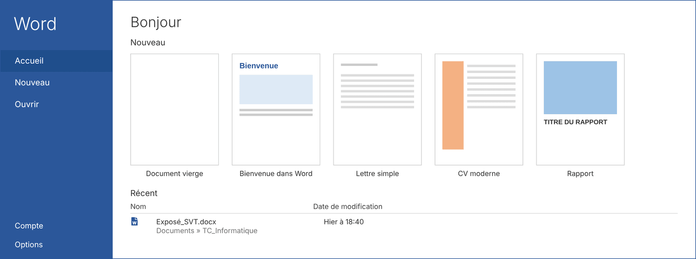

*Figure 1 : L'écran d'accueil de Word 2019.*

### 2.2 La fenêtre de Word 2019

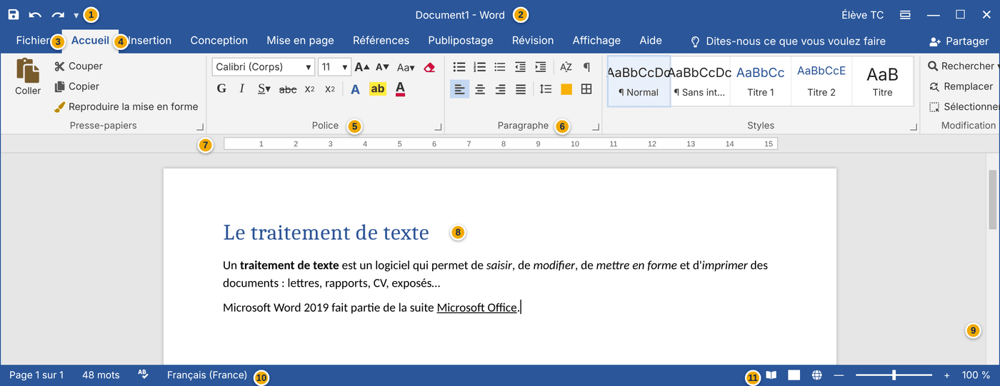

*Figure 2 : Les éléments de la fenêtre de Word 2019.*

| N° | Élément | Rôle |
|---|---|---|
| 1 | Barre d'outils Accès rapide | Commandes fréquentes : Enregistrer, Annuler, Rétablir ; personnalisable. |
| 2 | Barre de titre | Affiche le nom du document puis « Word » (Document1 tant qu'il n'est pas enregistré). |
| 3 | Onglet Fichier | Ouvre le mode Backstage : Nouveau, Ouvrir, Enregistrer, Enregistrer sous, Imprimer, Exporter, Fermer. |
| 4 | Onglets du ruban | Accueil, Insertion, Conception, Mise en page, Références, Publipostage, Révision, Affichage, Aide. |
| 5 | Ruban et groupe Police | Le ruban regroupe les commandes de l'onglet actif en groupes (Presse-papiers, Police, Paragraphe, Styles…). |
| 6 | Lanceur de boîte de dialogue | Petite flèche ⌟ en bas à droite d'un groupe : ouvre la boîte de dialogue complète (ex. Paragraphe). |
| 7 | Règle | Indique les marges et permet de régler les retraits et les tabulations (Affichage › Règle). |
| 8 | Zone de saisie et point d'insertion | Page où l'on tape le texte ; la barre verticale clignotante indique où le texte va s'écrire. |
| 9 | Barre de défilement | Permet de se déplacer dans un document long. |
| 10 | Barre d'état | Numéro de page, nombre de mots, état de l'orthographe, langue. |
| 11 | Modes d'affichage et zoom | Mode Lecture, Page, Web ; curseur de zoom (Ctrl + molette). |

### 2.3 Les onglets du ruban

| Onglet | Contenu principal |
|---|---|
| Accueil | Presse-papiers (couper, copier, coller), Police, Paragraphe, Styles, Rechercher/Remplacer |
| Insertion | Pages, Tableaux, Images, Formes, Icônes, SmartArt, En-tête/Pied de page, Numéro de page, Zone de texte, WordArt, Symboles |
| Conception | Thèmes, styles du document, Filigrane, Couleur de page, Bordures de page |
| Mise en page | Marges, Orientation, Taille, Colonnes, Sauts, Retraits et Espacement, Habillage |
| Références | Table des matières, notes de bas de page, citations |
| Révision | Grammaire et orthographe, Nombre de mots, Commentaires, Suivi des modifications |
| Affichage | Modes d'affichage, Règle, Quadrillage, Zoom, Fenêtres |

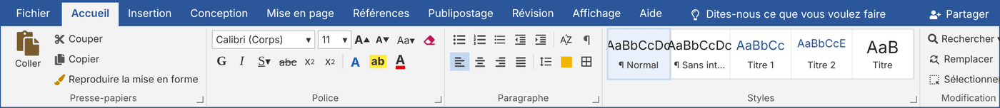

*Figure 3 : L'onglet Accueil et ses groupes.*

> **Remarque** : **Astuces**
>
> - Double-cliquer sur un onglet masque ou affiche le ruban (Ctrl + F1).
> - Les onglets contextuels (Format de l'image, Création de tableau…) n'apparaissent que lorsqu'un objet est sélectionné.
> - La zone « Dites-nous ce que vous voulez faire » permet de trouver une commande en tapant son nom.

### 2.4 Gérer ses documents

| Action | Méthode | Raccourci |
|---|---|---|
| Nouveau document | Fichier › Nouveau › Document vierge | Ctrl + N |
| Ouvrir | Fichier › Ouvrir › Parcourir | Ctrl + O |
| Enregistrer | Fichier › Enregistrer (ou icône disquette) | Ctrl + S |
| Enregistrer sous | Fichier › Enregistrer sous › Parcourir : choisir dossier, nom et type | F12 |
| Exporter en PDF | Fichier › Exporter › Créer PDF/XPS, ou Enregistrer sous › type PDF | — |
| Fermer le document | Fichier › Fermer | Ctrl + W |

> **Attention** : **Enregistrer souvent !**
>
> - Le premier enregistrement ouvre la boîte « Enregistrer sous » : on choisit l'emplacement (dossier), le nom du fichier et le type (.docx).
> - Ensuite, Ctrl + S met à jour le fichier. Une coupure de courant fait perdre tout ce qui n'a pas été enregistré.

## 3. Élaboration d'un document

Élaborer un document se fait en cinq étapes : la saisie, la mise en forme, l'insertion d'objets, la mise en page puis l'impression.

### 3.1 La saisie

Règles de saisie :

- **Ne jamais appuyer sur Entrée en fin de ligne** : Word passe automatiquement à la ligne suivante (retour à la ligne automatique). La touche Entrée sert uniquement à créer un nouveau paragraphe.
- Une seule espace entre deux mots. Ne pas utiliser d'espaces pour centrer ou aligner du texte : on utilise les commandes d'alignement.
- **Ponctuation française** : pas d'espace avant le point et la virgule ; une espace avant et après « : ; ! ? ».
- Saisir d'abord tout le texte, puis le mettre en forme.

| Touche | Rôle |
|---|---|
| Entrée ↵ | Termine un paragraphe et en commence un nouveau |
| Retour arrière ⌫ | Efface le caractère à gauche du point d'insertion |
| Suppr | Efface le caractère à droite du point d'insertion |
| Maj ⇧ | Écrit une majuscule ou le caractère du haut d'une touche |
| Verr Maj ⇪ | Bloque l'écriture en majuscules |
| Alt Gr | Écrit le 3e caractère d'une touche (@, #, €, [ ], { }…) |
| Tab ↹ | Insère une tabulation (décalage aligné) |
| Maj + Entrée | Retour à la ligne sans changer de paragraphe |
| Ctrl + Entrée | Saut de page |

Afficher les marques de mise en forme (bouton ¶ de l'onglet Accueil, Ctrl + Maj + 8) permet de voir les espaces (·), les paragraphes (¶) et les tabulations (→).

#### Sélectionner du texte

| Pour sélectionner… | Méthode |
|---|---|
| Un mot | Double-clic sur le mot |
| Une ligne | Clic dans la marge gauche, en face de la ligne |
| Un paragraphe | Triple-clic dans le paragraphe (ou double-clic dans la marge) |
| Une phrase | Ctrl + clic dans la phrase |
| Une zone quelconque | Glisser avec la souris, ou Maj + flèches |
| Tout le document | Ctrl + A |

#### Corriger et modifier

| Commande | Raccourci | Rôle |
|---|---|---|
| Annuler / Rétablir | Ctrl + Z / Ctrl + Y | Revenir en arrière / refaire l'action annulée |
| Couper, Copier, Coller | Ctrl + X, Ctrl + C, Ctrl + V | Déplacer ou dupliquer du texte |
| Rechercher | Ctrl + F | Trouver un mot (volet Navigation) |
| Remplacer | Ctrl + H | Remplacer un mot par un autre dans tout le document |
| Grammaire et orthographe | F7 | Vérifier tout le document (onglet Révision) |

> **À retenir** : **Les soulignements de Word**
>
> - Souligné ondulé rouge : faute d'orthographe probable (mot inconnu du dictionnaire).
> - Double soulignement bleu : erreur de grammaire ou de style probable.
> - Clic droit sur le mot souligné : Word propose des corrections.

### 3.2 La mise en forme

Mettre en forme, c'est modifier l'apparence du texte pour le rendre lisible et agréable. Il faut toujours sélectionner le texte avant d'appliquer une mise en forme.

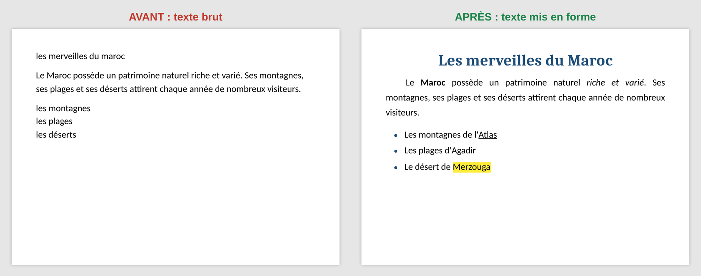

*Figure 4 : Le même texte avant et après mise en forme.*

#### a) Mise en forme des caractères (Accueil › groupe Police)

| Commande | Raccourci | Exemple |
|---|---|---|
| Police (type de caractères) | Ctrl + Maj + P | Calibri, Times New Roman, Arial… |
| Taille | Ctrl + Maj + > / < | 11, 14, 24 points |
| Gras | Ctrl + G | texte en gras |
| Italique | Ctrl + I | texte en italique |
| Souligné | Ctrl + U | texte souligné |
| Barré | — | texte barré |
| Indice / Exposant | Ctrl + = / Ctrl + Maj + + | H₂O  /  x² |
| Modifier la casse | Maj + F3 | minuscules, MAJUSCULES, 1re lettre… |
| Couleur de police / surlignage | — | texte en couleur, texte surligné |
| Effacer la mise en forme | Ctrl + Espace | revient au texte normal |

Le lanceur du groupe Police (Ctrl + D) ouvre la boîte de dialogue Police, qui regroupe tous ces réglages avec un aperçu.

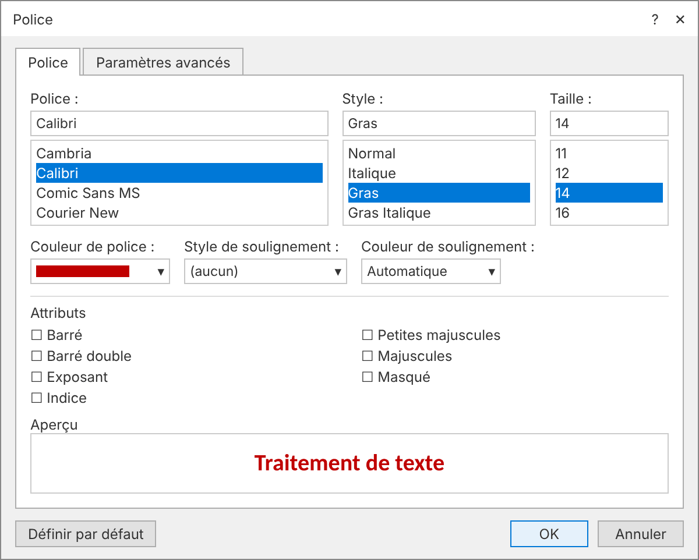

*Figure 5 : La boîte de dialogue Police.*

#### b) Mise en forme des paragraphes (Accueil › groupe Paragraphe)

| Réglage | Options et raccourcis |
|---|---|
| Alignement | À gauche (Ctrl + Maj + G), Centré (Ctrl + E), À droite (Ctrl + Maj + D), Justifié (Ctrl + J) |
| Retraits | Gauche, droit, première ligne (alinéa), suspendu : décalage du paragraphe par rapport aux marges |
| Interligne | Espace entre les lignes : 1 ; 1,15 ; 1,5 ; 2 … |
| Espacement | Espace avant et après le paragraphe (en points) |
| Puces et numérotation | Listes à puces (•, ✓, ➢) ou numérotées (1., a), I.) |
| Bordures et trame | Encadrer un paragraphe ou lui appliquer une couleur de fond |

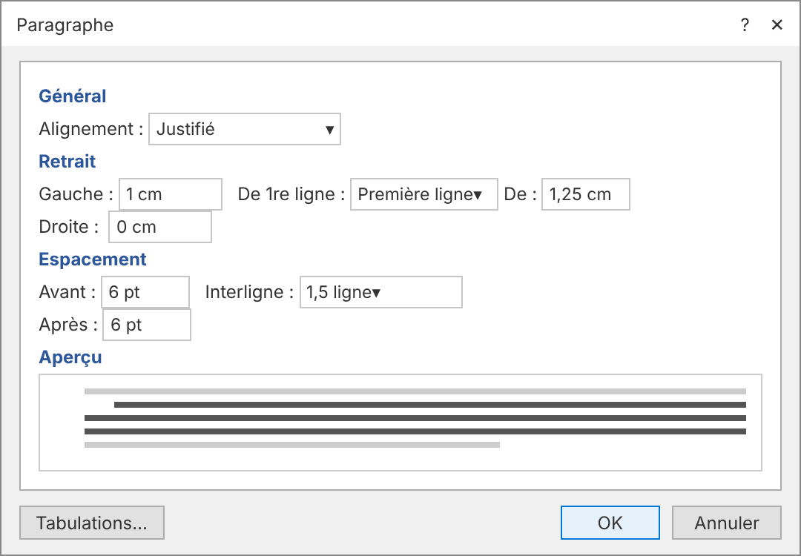

*Figure 6 : La boîte de dialogue Paragraphe.*

#### c) Outils pratiques

- **Reproduire la mise en forme (pinceau)** : copie la mise en forme d'un texte vers un autre. Double-clic sur le pinceau pour l'appliquer plusieurs fois.
- **Styles (Normal, Titre 1, Titre 2…)** : mise en forme prédéfinie à appliquer d'un clic ; ils servent aussi à créer une table des matières automatique.
- **Lettrine (Insertion › Lettrine)** : grande première lettre au début d'un paragraphe.

### 3.3 L'insertion d'objets (onglet Insertion)

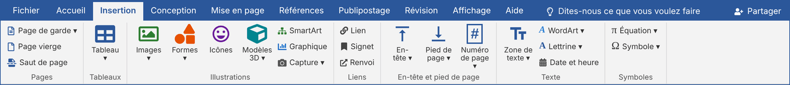

*Figure 7 : L'onglet Insertion.*

| Objet | Comment l'insérer |
|---|---|
| Image | Insertion › Images › Cet appareil (fichier de l'ordinateur) ou Images en ligne |
| Forme | Insertion › Formes : choisir la forme puis la tracer en glissant |
| Icônes / SmartArt | Insertion › Icônes ; Insertion › SmartArt (organigrammes, cycles, listes graphiques) |
| Tableau | Insertion › Tableau : glisser sur la grille (ex. 3 × 4) ou Insérer un tableau… |
| Zone de texte | Insertion › Zone de texte › Dessiner une zone de texte |
| WordArt | Insertion › WordArt : texte décoratif |
| Symbole / Équation | Insertion › Symbole (©, €, ♥, α…) ; Insertion › Équation |
| En-tête / Pied de page | Insertion › En-tête ou Pied de page : texte répété sur chaque page ; double-clic dans le corps pour sortir |
| Numéro de page | Insertion › Numéro de page › Bas de page |

Quand un objet est sélectionné, un onglet contextuel apparaît (Format de l'image, Format de la forme, Création de tableau, Disposition…) pour le modifier : taille, styles, bordure, rotation, rognage.

#### Tableaux

- **Se déplacer d'une cellule à la suivante** : touche Tab (Maj + Tab pour revenir).
- **Insérer une ligne ou une colonne** : clic droit › Insérer, ou onglet Disposition.
- **Fusionner des cellules** : sélectionner les cellules › clic droit › Fusionner les cellules.
- **Mettre en forme** : onglet Création de tableau › Styles de tableau, Trame de fond, Bordures.

#### Habillage du texte

L'habillage définit la position du texte autour d'une image ou d'une forme (Format de l'image › Habillage, ou bouton Options de disposition à côté de l'image).

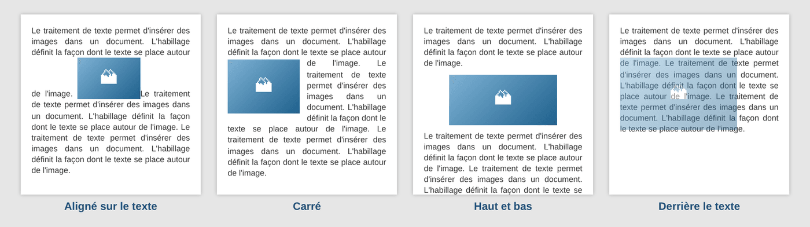

*Figure 8 : Quelques types d'habillage du texte.*

### 3.4 La mise en page (onglet Mise en page)

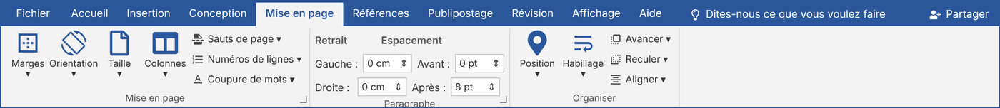

*Figure 9 : L'onglet Mise en page.*

| Réglage | Rôle et valeurs courantes |
|---|---|
| Marges | Espaces blancs autour du texte : Normales (2,5 cm), Étroites, Larges, Personnalisées |
| Orientation | Portrait (vertical) ou Paysage (horizontal) |
| Taille | Format du papier : A4 (21 × 29,7 cm), A5, Letter… |
| Colonnes | Une, deux, trois colonnes (style journal) |
| Sauts | Saut de page (Ctrl + Entrée), saut de colonne, saut de section |
| Retrait et espacement | Réglages rapides du paragraphe sélectionné |

Dans l'onglet Conception, le groupe Arrière-plan de la page propose : Filigrane (texte en transparence, ex. « CONFIDENTIEL »), Couleur de page et Bordures de page.

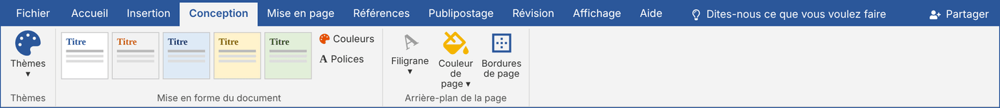

*Figure 10 : L'onglet Conception.*

### 3.5 L'impression

Avant d'imprimer, on vérifie toujours l'aperçu pour éviter de gaspiller du papier et de l'encre. Fichier › Imprimer (Ctrl + P) affiche à la fois les paramètres et l'aperçu.

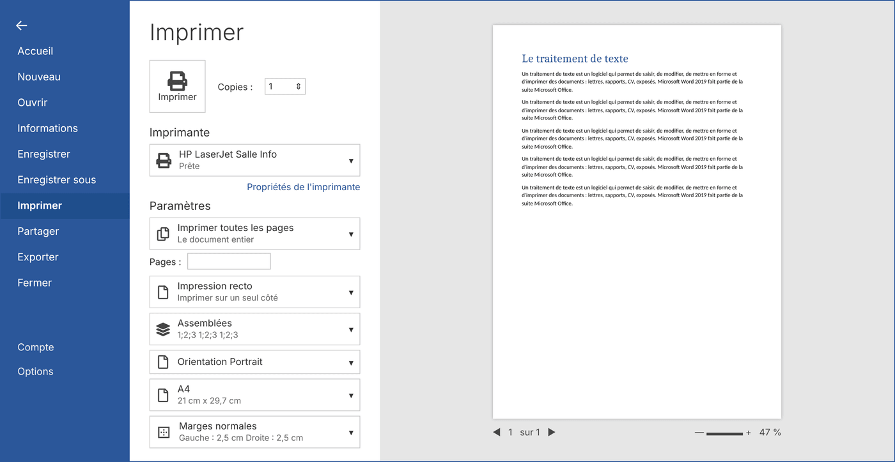

*Figure 11 : Fichier › Imprimer : paramètres et aperçu.*

| Paramètre | Rôle |
|---|---|
| Copies | Nombre d'exemplaires à imprimer |
| Imprimante | Choix de l'imprimante (ou « Microsoft Print to PDF ») |
| Pages | Toutes les pages, page active, ou pages précises : « 1-3 » (de 1 à 3), « 1;4 » (pages 1 et 4) |
| Recto / Recto verso | Impression sur un ou deux côtés de la feuille |
| Assemblées | Ordre des pages lorsqu'il y a plusieurs copies |
| Orientation, taille, marges | Derniers réglages de la mise en page |

> **À retenir** : **Les étapes d'élaboration**
>
> 1. Saisir  →  2. Mettre en forme  →  3. Insérer des objets  →  4. Mettre en page  →  5. Vérifier l'aperçu et imprimer.
>
> - Et à chaque étape : enregistrer (Ctrl + S) !
