# Chapitre 2 : Exercices

*Module 1 : Généralités sur les systèmes informatiques*

## Exercice 1 : Identifier les périphériques

Pour chacune des 16 images, donner le nom du périphérique et son type.

### Image 1

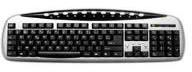

Nom : ……………………  Type (entrée / sortie / entrée-sortie) : ……………………

Afficher la correction

**Clavier** (**entrée**)

### Image 2

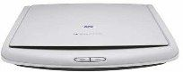

Nom : ……………………  Type (entrée / sortie / entrée-sortie) : ……………………

Afficher la correction

**Scanner** (**entrée**)

### Image 3

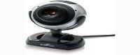

Nom : ……………………  Type (entrée / sortie / entrée-sortie) : ……………………

Afficher la correction

**Webcam** (**entrée**)

### Image 4

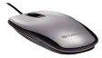

Nom : ……………………  Type (entrée / sortie / entrée-sortie) : ……………………

Afficher la correction

**Souris** (**entrée**)

### Image 5

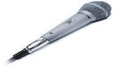

Nom : ……………………  Type (entrée / sortie / entrée-sortie) : ……………………

Afficher la correction

**Microphone** (**entrée**)

### Image 6

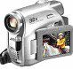

Nom : ……………………  Type (entrée / sortie / entrée-sortie) : ……………………

Afficher la correction

**Caméscope** (**entrée**)

### Image 7

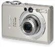

Nom : ……………………  Type (entrée / sortie / entrée-sortie) : ……………………

Afficher la correction

**Appareil photo numérique** (**entrée**)

### Image 8

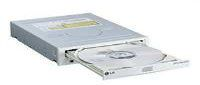

Nom : ……………………  Type (entrée / sortie / entrée-sortie) : ……………………

Afficher la correction

**Lecteur CD/DVD** (**entrée**)

### Image 9

Nom : ……………………  Type (entrée / sortie / entrée-sortie) : ……………………

Afficher la correction

**Écran** (**sortie**)

### Image 10

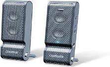

Nom : ……………………  Type (entrée / sortie / entrée-sortie) : ……………………

Afficher la correction

**Haut-parleurs** (**sortie**)

### Image 11

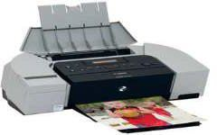

Nom : ……………………  Type (entrée / sortie / entrée-sortie) : ……………………

Afficher la correction

**Imprimante** (**sortie**)

### Image 12

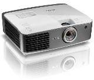

Nom : ……………………  Type (entrée / sortie / entrée-sortie) : ……………………

Afficher la correction

**Vidéoprojecteur** (**sortie**)

### Image 13

Nom : ……………………  Type (entrée / sortie / entrée-sortie) : ……………………

Afficher la correction

**Modem/routeur** (**entrée-sortie**)

### Image 14

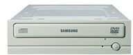

Nom : ……………………  Type (entrée / sortie / entrée-sortie) : ……………………

Afficher la correction

**Graveur DVD** (**entrée-sortie**)

### Image 15

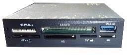

Nom : ……………………  Type (entrée / sortie / entrée-sortie) : ……………………

Afficher la correction

**Lecteur de cartes mémoire** (**entrée-sortie**)

### Image 16

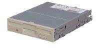

Nom : ……………………  Type (entrée / sortie / entrée-sortie) : ……………………

Afficher la correction

**Lecteur de disquettes** (**entrée-sortie**)

## Exercice 2 : Compléter le schéma fonctionnel d'un ordinateur

Nommer les 6 cases numérotées du schéma fonctionnel d'un ordinateur :

1. La grande case à gauche : ……………………
2. La case du haut : ……………………
3. La barre du milieu : ……………………
4. La case en bas à gauche : ……………………
5. La case en bas à droite : ……………………
6. La case du bas : ……………………

Afficher la correction

1. **Unité centrale de traitement** (microprocesseur)
2. **Mémoire centrale**
3. **Système de bus**
4. **Unités d'entrée**
5. **Unités de sortie**
6. **Unités de stockage**

## Exercice 3 : Compléter le schéma du Résumé

Compléter les cases du schéma du Résumé :

- a) mémoire en lecture/écriture : ……………………
- b) mémoire en lecture seule : ……………………
- c, d, e) les trois éléments du CPU : ……………………
- f, g) deux exemples d'unités d'entrée : ……………………
- h, i) deux exemples d'unités de sortie : ……………………

Afficher la correction

- a) **RAM**
- b) **ROM**
- c, d, e) **UAL**, **UC**, **Registres** (ordre libre)
- f, g) par exemple : **clavier**, **souris** (tout exemple valable)
- h, i) par exemple : **écran**, **imprimante** (tout exemple valable)

