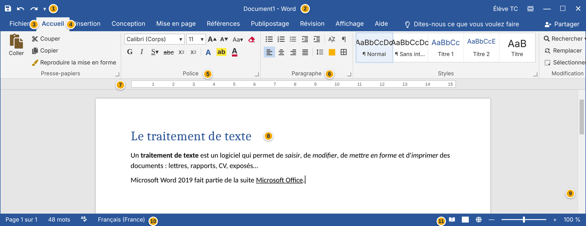
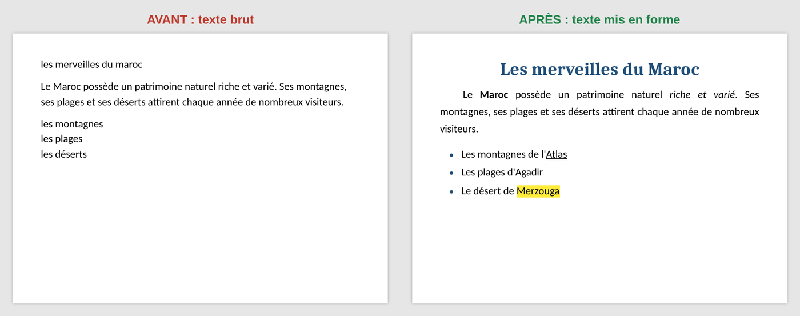

# Exercices du chapitre 2 : Traitement de texte

## Exercice 1 : Questions de cours

**1.** Définir un traitement de texte (texteur).

Afficher la correction

Un traitement de texte est un logiciel d'application qui permet de saisir, modifier, mettre en forme, enrichir (images, tableaux…), enregistrer et imprimer des documents textuels.

**2.** Citer trois logiciels de traitement de texte.

Afficher la correction

Microsoft Word, LibreOffice Writer, Google Docs (aussi WPS Writer, WordPad).

**3.** Que signifie l'expression WYSIWYG ?

Afficher la correction

**What You See Is What You Get** (« ce que vous voyez est ce que vous obtenez ») : le document imprimé a le même aspect que le document affiché à l'écran.

**4.** Quelle est la différence entre le Bloc-notes et Microsoft Word ?

Afficher la correction

Le Bloc-notes est un éditeur de texte brut (`.txt`), sans mise en forme. 
Word est un traitement de texte : il gère les polices, la mise en forme, les images, les tableaux et la mise en page.

**5.** Citer, dans l'ordre, les cinq étapes de l'élaboration d'un document.

Afficher la correction

Saisie › mise en forme › insertion d'objets › mise en page › impression.

## Exercice 2 : Vrai ou Faux

Répondre par **Vrai** ou **Faux** et corriger les affirmations fausses.

**1.** Il faut appuyer sur Entrée à la fin de chaque ligne.

Afficher la correction

**Faux.** Word passe automatiquement à la ligne ; la touche Entrée sert à créer un nouveau paragraphe.

**2.** L'extension par défaut d'un document Word 2019 est `.docx`.

Afficher la correction

**Vrai.**

**3.** Le raccourci Ctrl + G met le texte en gras.

Afficher la correction

**Vrai.** (version française de Word)

**4.** Un mot souligné en rouge ondulé contient peut-être une faute d'orthographe.

Afficher la correction

**Vrai.**

**5.** L'orientation Paysage est l'orientation verticale de la feuille.

Afficher la correction

**Faux.** Paysage est l'orientation horizontale ; Portrait est l'orientation verticale.

**6.** L'en-tête se répète en haut de chaque page du document.

Afficher la correction

**Vrai.**

**7.** Pour imprimer seulement les pages 2 à 5, on tape « 2;5 » dans la zone Pages.

Afficher la correction

**Faux.** Il faut taper « 2-5 » ; « 2;5 » imprime seulement les pages 2 et 5.

## Exercice 3 : QCM

Choisir la (ou les) bonne(s) réponse(s).

**1.** Pour sélectionner un paragraphe, on fait : a) un double-clic ; b) un triple-clic ; c) un clic droit.

Afficher la correction

**b)**

**2.** Le raccourci pour centrer un paragraphe est : a) Ctrl + C ; b) Ctrl + E ; c) Ctrl + J.

Afficher la correction

**b)** (Ctrl + C copie ; Ctrl + J justifie.)

**3.** Les marges se règlent dans l'onglet : a) Accueil ; b) Insertion ; c) Mise en page.

Afficher la correction

**c)**

**4.** Un filigrane s'insère depuis l'onglet : a) Conception ; b) Révision ; c) Affichage.

Afficher la correction

**a)**

**5.** Pour remplacer un mot dans tout le document, on utilise : a) Ctrl + F ; b) Ctrl + H ; c) Ctrl + R.

Afficher la correction

**b)**

**6.** Pour enregistrer un document sous un autre nom : a) Ctrl + S ; b) F12 ; c) Ctrl + P.

Afficher la correction

**b)**

**7.** Pour écrire H₂O, le « 2 » est en : a) exposant ; b) indice ; c) italique.

Afficher la correction

**b)**

## Exercice 4 : Reconnaître les éléments de la fenêtre

Observer la fenêtre de Word 2019 ci-dessous et nommer les éléments numérotés de 1 à 11.

*Fenêtre de Word 2019 à légender.*

Afficher la correction

1. Barre d'outils Accès rapide
2. Barre de titre
3. Onglet Fichier
4. Onglets du ruban (onglet Accueil actif)
5. Ruban : groupe Police
6. Lanceur de boîte de dialogue (groupe Paragraphe)
7. Règle
8. Zone de saisie (point d'insertion)
9. Barre de défilement
10. Barre d'état
11. Modes d'affichage et zoom

## Exercice 5 : Associer la commande à son onglet

Pour chaque commande, indiquer l'onglet du ruban où elle se trouve : Accueil, Insertion, Conception, Mise en page ou Révision.

| Commande | Onglet |
|---|---|
| Gras, italique, souligné | ……… |
| Tableau | ……… |
| Orientation Paysage | ……… |
| Bordures de page | ……… |
| Grammaire et orthographe | ……… |
| Numéro de page | ……… |
| Puces et numérotation | ……… |
| Colonnes | ……… |

Afficher la correction

| Commande | Onglet |
|---|---|
| Gras, italique, souligné | Accueil |
| Tableau | Insertion |
| Orientation Paysage | Mise en page |
| Bordures de page | Conception |
| Grammaire et orthographe | Révision |
| Numéro de page | Insertion |
| Puces et numérotation | Accueil |
| Colonnes | Mise en page |

## Exercice 6 : Les raccourcis clavier

Compléter le tableau.

| Action | Raccourci |
|---|---|
| Copier | ……… |
| Coller | ……… |
| Annuler | ……… |
| Enregistrer | ……… |
| Imprimer | ……… |
| Tout sélectionner | ……… |
| Justifier | ……… |
| Italique | ……… |

Afficher la correction

| Action | Raccourci |
|---|---|
| Copier | Ctrl + C |
| Coller | Ctrl + V |
| Annuler | Ctrl + Z |
| Enregistrer | Ctrl + S |
| Imprimer | Ctrl + P |
| Tout sélectionner | Ctrl + A |
| Justifier | Ctrl + J |
| Italique | Ctrl + I |

## Exercice 7 : Analyser une mise en forme

Observer le document « avant » et le document « après », puis citer toutes les mises en forme appliquées au document « après » (caractères, paragraphes et listes). Préciser, pour chacune, le groupe du ruban utilisé.

*Le même texte avant et après mise en forme.*

Afficher la correction

- **Titre** : autre police (Cambria), grande taille, gras, couleur bleue, majuscules en début de mots (groupe Police) ; centré (groupe Paragraphe).
- **Paragraphe** : justifié, retrait de première ligne, interligne augmenté (groupe Paragraphe).
- « Maroc » en **gras**, « riche et varié » en *italique* (groupe Police).
- Liste à puces de couleur (groupe Paragraphe › Puces).
- « Atlas » souligné et « Merzouga » surligné en jaune (groupe Police).

## Exercice 8 : Situation-problème

Youssef doit rendre un exposé de 3 pages sur « L'eau au Maroc ». Il a tout saisi, mais : le titre est en minuscules et à gauche ; il a utilisé des espaces pour décaler ses paragraphes ; aucune page n'est numérotée ; il veut imprimer 2 exemplaires de la page 1 seulement.

**1.** Quelles commandes doit-il utiliser pour mettre le titre en majuscules, en gras, en taille 20 et centré ?

Afficher la correction

Sélectionner le titre › Modifier la casse › MAJUSCULES (ou Maj + F3) ; Gras (Ctrl + G) ; taille 20 ; Centrer (Ctrl + E).

**2.** Comment doit-il décaler correctement la première ligne de chaque paragraphe ?

Afficher la correction

Supprimer les espaces, puis régler un retrait de première ligne : boîte Paragraphe › Retrait › De 1re ligne : Première ligne, 1 cm (ou utiliser la règle).

**3.** Comment numéroter les pages en bas, au centre ?

Afficher la correction

Insertion › Numéro de page › Bas de page › Numéro normal 2 (centré).

**4.** Quels réglages doit-il faire dans Fichier › Imprimer ?

Afficher la correction

Copies : **2** ; Pages : **1** (ou « Imprimer la page active » si le curseur est sur la page 1) ; vérifier l'aperçu puis cliquer sur Imprimer.

**5.** Il veut envoyer son exposé à son professeur sans que la présentation change. Quel format doit-il choisir ? Comment ?

Afficher la correction

Le format **PDF** : Fichier › Exporter › Créer PDF/XPS, ou Enregistrer sous › Type : PDF.

